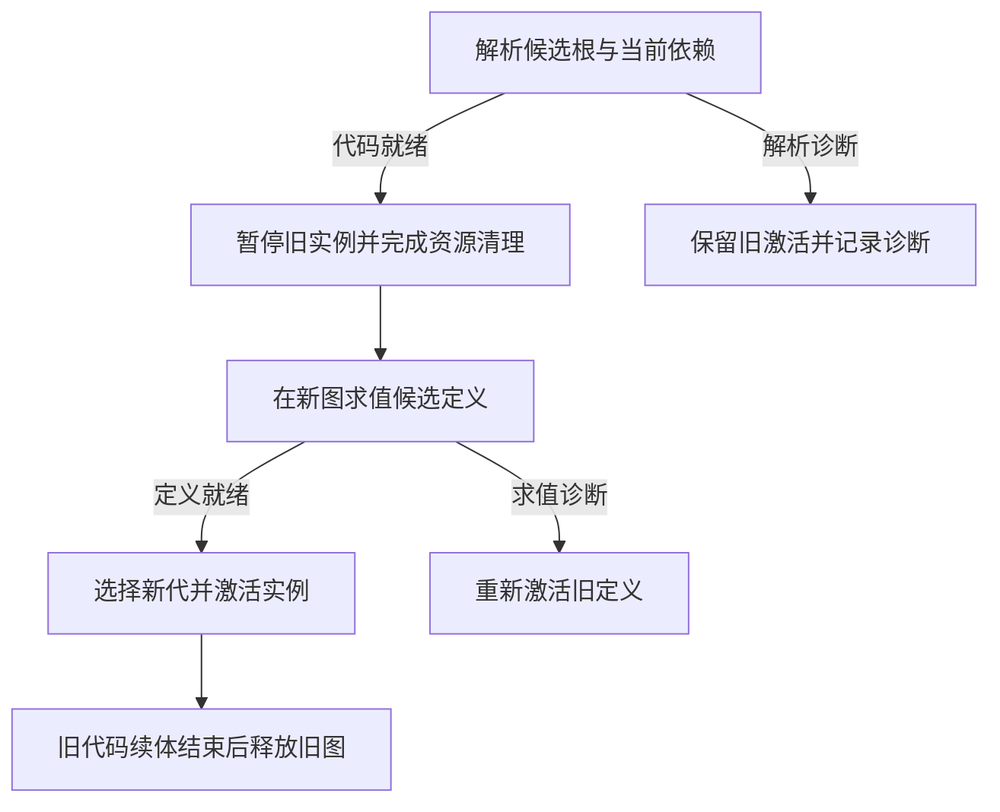

# Cordis-Bun

以 [Cordis Core](https://github.com/cordiverse/cordis) 为基线的组合内核派生项目。安装 Bun `1.4.4` 即可从源码启动应用、加载 TypeScript 插件、刷新配置和进行插件代码热更新；Context、Fiber、命名服务、作用域隔离与事件分派沿用 Cordis 组合模型。

上游基线：[`66633488b4964857e66f3f618cd57a6bb7068da0`](https://github.com/cordiverse/cordis/tree/66633488b4964857e66f3f618cd57a6bb7068da0)，核心包版本 `4.0.0-rc.12`。上游作者署名与 MIT 授权保留在 [LICENSE](./LICENSE)。

## 运行约束

- 正式运行以 Bun 单运行时为硬性要求：依赖安装、启动、配置和插件加载、生命周期收尾均使用 Bun。
- 构建、类型检查、lint 和对照测试按现有成熟工具组织；全仓工具链统一为 Bun 属于可选优化。
- 启动验收使用干净源码检出，安装依赖后直接启动，并在隔离环境中屏蔽 Node 可执行文件及既有构建产物。

## 启动应用

```sh
bun install --frozen-lockfile
bun run start
```

入口优先选择工作目录中的 `app.yml`，随后选择 `cordis.yml`。本仓库的 `cordis.yml` 提供日志、文件、定时器与原生 Bun HMR 的默认组合。`bun run start --help` 显示显式配置路径及 `run` 前缀的用法。

Bun 按包的 `bun` 条件直接加载 `src`；运行包同时发行源码。正式启动直接进入 Bun 宿主，构建产物用于 Node 开发与对照入口。配置文件由 Include 监听，代码文件由 Bun HMR 监听。

宿主处理 `SIGINT` 与 `SIGTERM`：先关闭新导入，发布退出通知，再等待实例、资源和代码执行单元收尾。并发停止请求共享同一停止结果。启动诊断以 `loader.errors` 与实例状态为依据；就绪后输出 `Cordis ready`，启动诊断对应退出码 `1`，业务日志独立遵循日志契约。

## 开发

使用 Bun `1.4.4`。继承的构建工具与完整 Vitest 套件使用 Node.js `24` 或 `26`；包管理器集成测试还会调用 npm、pnpm，以及由 fixture 的 `packageManager` 选择的 Yarn 1.x / 4.x。运行完整套件前应在 PATH 中准备 Corepack 的 Yarn 入口；这些是开发验收工具，不是应用正式运行时依赖。

```sh
bun install --frozen-lockfile
bun run typecheck
bun run test:core
bun run test:bun
bun run build
bun run test
bun run lint
```

- `typecheck` 检查内核源码。
- `test:core` 运行内核回归测试，包含上游依赖、隔离、事件和配置更新语义。
- `test:bun` 运行真实 Bun 内核、ModuleGraph 与 HMR 场景，覆盖构造失败的代码引用回收、HTTP、定时器、SDK/别名身份、旧代导入、严格租约、候选诊断与依赖消费者恢复。
- `test:bun:only` 在 Linux bubblewrap 中复制源码、隔离原工作区并屏蔽宿主 Node；完成锁定安装、正式入口启动、HTTP、配置刷新、同进程代码热更新、信号收尾和启动诊断验收。该开发验收命令使用 bubblewrap；正式运行使用 Bun。
- CI 的 `bun-runtime` 作业在 `oven/bun:1.4.4` 镜像中执行同一套源码验收。Bun 运行时及 `bun run` 创建的 `node` 兼容别名通过文件设备号与 inode 核对为 Bun 自身。
- `test` 运行完整工作区测试。Node Loader/HMR 作为开发与对照后端，Yakumo 提供工作区源码解析。
- `build` 沿用上游 esbuild 与 TypeScript 声明构建。

## 内核契约

### 组合与依赖

`plugin` 挂载实例，`inject` 表达必需依赖，`optional` 声明可选依赖，`provide` 提供命名服务。`scope` 创建透明子服务视图；`isolate` 保留原有硬隔离边界。`effect` 与 `resources` 分别提供原生 effect 初始化协议和显式资源所有权。

实例所有权树控制子实例收尾；服务依赖图控制消费者重新激活；代码依赖图由 Loader 管理。插件默认共享进程并直接调用服务，群级配置与派发条件由产品服务索引。

一次激活使用固定的依赖与自身提供服务视图。旧消费者在途工作和清理期间继续访问旧服务，提供者在消费者释放依赖后清理资源；旧 Context 不会读取或改写替代激活的自身服务。既有消费者及继承服务的子实例，其收尾事件继续调用绑定提供者的监听器，异步回调在提供者释放资源前完成。

#### 按名称读取服务

使用公开静态方法 `ReflectService.getBinding(ctx, name)` 读取命名绑定。它与普通服务属性分支共用声明检查、`internal/get` 中间件、trace/shadow 和已提交依赖快照：缺少已声明的可选服务时返回 `undefined`，未声明访问和已失活的必需依赖仍报错。传入 Context 的定义端决定依赖声明，旧激活在途工作与清理期间仍读取其已提交绑定。

该方法不经过 Context 的物理属性检查或属性名过滤，因此 `_service`、`resources`、`scope` 等服务名也能按原 ID 解析，而不会覆盖 `ctx.resources`、`ctx.scope` 等原生字段。返回类型是 `unknown`，调用方按自己的服务契约收窄类型。根 Context 和透明子作用域继续使用原有的未检查管理读取；`ctx.get(name, strict?)` / `ctx.reflect.get(name, strict?)` 的当前服务视图查询语义不变。

`ReflectService.isBindingViewOpen(ctx)` 查询捕获的原生激活是否完成最终清理。独立 `ResourceScope.dispose()` 完成不代表该激活的原生 effect 与依赖清理已经结束；类型化门面应使用这个边界判断旧视图是否仍可读，而不是自行推断 Fiber 当前代或资源状态。

```js
import { Context, ReflectService } from 'cordis'

const root = new Context()
root.provide('resources', 42)
await root.plugin({
  inject: ['resources'],
  apply(ctx) {
    console.log(ReflectService.getBinding(ctx, 'resources')) // 42
    console.log(ctx.resources.active) // true，原生资源所有者未被服务覆盖
  },
})
await root.fiber.dispose()
```

#### 可选依赖

插件的 `optional?: Inject` 与 `inject` 使用相同的数组或配置字典格式。缺少可选服务不阻止激活，声明处的属性访问返回 `undefined`；同名服务同时出现在两者中时仍为必需依赖。提供者出现、撤销或绑定身份变化只重新激活相应服务视图内声明该依赖的消费者，不影响未声明依赖的实例和隔离的兄弟视图。

```js
import { Context } from 'cordis'

const root = new Context()
const consumer = await root.plugin({
  optional: ['clock'],
  apply(ctx) {
    console.log(ctx.clock?.now() ?? 'clock unavailable')
  },
})
const withdraw = root.provide('clock', { now: () => Date.now() })
await consumer.await()
await withdraw()
await root.fiber.dispose()
```

#### 透明子作用域与可逆覆盖

`ctx.scope(label?)` 返回一个由当前实例拥有的子 Context。子视图优先解析本地绑定，未提供时回退到祖先；兄弟视图不共享本地绑定。通过 `child.fiber.await()` 等待就绪，通过 `child.fiber.dispose()` 关闭该视图及其子实例。父实例退出也会关闭它。`ctx.isolate(name, symbol?)` 仍建立该名字的硬边界，不回退到外层绑定，也不继承跨边界的依赖声明。

`provide(name, value, options?)` 默认拒绝同一视图、同一隔离槽内的重复登记。显式传入 `{ replace: true }` 压入一层覆盖，调用返回的异步注销函数后恢复仍存在的下层绑定；提前撤销隐藏层不会使其再次出现。`options.check` 保留原生服务检查，第三个参数直接传检查函数的既有用法也不变。

```js
import { Context } from 'cordis'

const root = new Context()
root.provide('greeting', 'root')
const child = root.scope('child')
await child.fiber.await()
const clearLocal = child.provide('greeting', 'child')
const restore = child.provide('greeting', 'replacement', { replace: true })
console.log(child.greeting, root.greeting) // replacement, root
await restore()
console.log(child.greeting) // child
await clearLocal()
console.log(child.greeting) // root
console.log(child.isolate('greeting').get('greeting')) // undefined
await root.fiber.dispose()
```

装饰器插件可以先声明 `inject: ['foo']`、捕获下层服务，再用 `provide('foo', wrapped, { replace: true })` 登记包装服务。该实例的依赖仍绑定在自身最底层覆盖之下，不会因自己或后续装饰器的发布而依赖自身、相互形成循环或反复重启。包装服务的消费者与装饰器均使用原生依赖快照；下层提供者在旧消费者清理完成后才释放资源。

异步初始化登记的服务只在激活成功后向外发布。初始化代码可以读取自身暂存的服务，但失败、过期或已退休的初始化不会覆盖当前对外选择的服务；已有有效下层绑定在候选初始化期间继续可用。

Loader 的隔离迁移由原生反射层按实际物理 scope 搬移当前条目拥有的覆盖层，保持绑定标识及已提交消费者快照；无关层留在原位，目标槽冲突时保留原绑定。通知与祖先回退刷新按 `(scope, isolation)` 分别路由，其他 realm 的本地层不会遮蔽本 realm 的撤回。必需和可选消费者都重新解析，空物理槽立即回收键映射；旧依赖快照只保留到该次激活清理完成。

### 资源与停止

- effect 在初始化之前登记归属。初始化晚到的释放函数进入同一条清理路径。
- 手工启动的异步资源清理继续归属于原实例，直至清理完成。
- 函数声明、箭头函数和异步工厂返回的 effect 均进入资源清理路径；构造实例与可调用 Service 继续通过实例初始化协议运行。
- 同一复合 effect 逆序释放。独立子实例并发收尾，其余资源在子实例与绑定回调结束后并发释放。清理覆盖全部已登记资源，异常通过 `AggregateError` 汇总。
- 同一实例的并发 `dispose()` 共享清理完成结果。插件实例与根实例均以 `DISPOSED` 结束；重复调用等待同一轮结果。
- 清理诊断历史与单次生命周期结果分别记录。已经完成并由原操作报告的旧激活失败，不在后续干净停止、恢复或缺少依赖时的显式重启中重放；停止或挂起仍报告自己实际执行或加入的清理失败。历史记录仍供原 receipt 与诊断读取。
- 停止请求同步关闭新业务和长期资源登记入口，并沿所有权树传递取消。子实例在所属 effect 的清理位置完成退出，复合 effect 保持登记的逆序。生命周期控制仍可提交最新配置目标。

#### 每次激活的 ResourceScope

`ctx.resources` 是当前激活的固定资源所有者，不是动态查询 Fiber 当前代的 getter。重新激活后，`fiber.ctx` 指向新 Context；保存的旧 Context、服务 shadow 和资源所有者仍指向旧激活。根 Context 同样拥有 ResourceScope，不依赖普通 effect 的登记。

| 接口 | 行为 |
| --- | --- |
| `active`、`signal` | 当前是否接受登记，以及同步退休时中止的信号 |
| `onRetire(callback)` | 退休时同步撤销外部登记；返回取消该钩子的函数 |
| `effect(cleanup, label?)` | 直接登记清理函数，返回幂等的异步释放函数；不是 `ctx.effect()` 的初始化工厂 |
| `acquire()` | 接受时返回幂等租约释放函数，退休后返回 `undefined` |
| `run(execute)` | 进入创建时捕获的执行单元并保留确切资源归属；不把旧回调转交新代码代，也不自动取得租约 |
| `retire()`、`dispose()` | 前者同步关闭登记和中止信号，后者等待严格租约并按 LIFO 清理全部资源 |
| `diagnostics()` | 资源标签、active/retiring/disposed 状态、严格租约数与清理异常 |

停止或依赖重启同步调用 `retire()`，随后等待在途任务、旧消费者及严格租约，再清理该激活的资源与原生 effect，最后释放提供者依赖。清理尝试覆盖全部资源，异常合并进原生实例的 `lastError` 与停止结果。`run()` 在退休但尚未最终释放时仍可运行已获准的回调；最终释放后拒绝执行。

```js
import { Context } from 'cordis'

const root = new Context()
const instance = await root.plugin((ctx) => {
  ctx.resources.effect(() => console.log('resource closed'), 'connection')
})
const owner = instance.ctx.resources
const release = owner.acquire()
if (!release) throw new Error('activation already retired')
const stopping = instance.dispose()
try {
  owner.run(() => console.log('admitted old activation'))
} finally {
  release()
}
await stopping
await root.fiber.dispose()
```

严格资源租约与 `ctx.task()` / `ctx.join()` 的生命周期交接不同。多所有者执行计划必须在第一次 `await` 前获取各所有者租约，并在 `finally` 释放；租约保护资源和代码，不能在持有自己严格租约时等待自己的最终 `dispose()`。将调用包装为 `ctx.task()` 不会使严格租约自动脱离或提前释放。

### 在途工作

使用 `ctx.task((signal) => work, label)` 登记插件主动启动的工作。同步回调保留同步返回与异常；异步工作返回可追踪的完成值。业务等待项在工作完成或下述生命周期交接时结算，`fiber.getTasks()` 提供当前等待项的标签与取消信号视图。

业务事件和定时器回调自动关联所属实例。`internal/*` 由宿主协调分派，用户监听器按登记时的执行单元运行，控制入口保留可调用注销句柄。停止先请求取消并等待在途工作，再释放其依赖资源。取消使用 `AbortSignal` 的协作式语义，CPU 调度由 Worker 等执行设施承接。

事件保持 `emit`、`parallel`、`serial`、`bail` 和 `waterfall` 的分派契约。普通服务调用采用函数调用；错误策略由各入口定义，`emit` 与定时器的异步回调使用所属插件的日志入口，`parallel` 和 `serial` 保留返回值上的异常传播。

#### 生命周期等待关系

处理器可以直接 `await ctx.fiber.dispose()`、`await ctx.fiber.restart()` 或 `await ctx.fiber.update(config)`。消费这些控制完成值时，当前工作把业务等待责任交给生命周期操作，返回值仍等待真实清理或重新激活完成。控制完成值绑定发起时的激活代，已登记的控制等待在该代进入收尾时重新判定；后续激活代的业务独立结算。等待后的代码属于管理收尾，新一轮业务通过新激活范围的 `ctx.task()` 登记。

在受管工作内等待另一项受管任务或事件组合，使用 `ctx.join()` 明确登记等待关系：

```ts
ctx.on('maintenance', async () => {
  await ctx.join(ctx.task(async () => {
    await saveCurrentState()
    await ctx.fiber.restart()
  }, 'save and restart'))
})
```

`ctx.join()` 用于紧接着 `await` 或直接返回的受管完成值；普通外部 Promise 保留原生等待行为。`parallel`、`serial` 以及完成值的链式组合记录各自实际消费的子操作，直接返回的受管完成值也形成等待关系。处理器内的嵌套任务与派发通过 `ctx.join()` 声明依赖，原生 `await` 的内部关系由调用方显式表达。

独立后台工作直接启动 `ctx.task()`，各自保留收尾责任。异步上下文用于定位当前执行记录；等待图仅采用已声明的依赖边。因此，同一实例内由某项工作发起的自停，会等待仍独立执行的其他工作。生命周期完成值与任务结果均保留实际完成和异常信息。

### 配置目标收敛

| 观察项 | 含义 |
| --- | --- |
| `fiber.config` | 最新提交的目标配置，承接原有配置接口 |
| `fiber.effective` | 最近一次成功激活或原地更新所接受的配置 |
| `fiber.revision` | 单调递增的目标序号，配置提交与激活目标变化均推进 |
| `fiber.lastError` | 当前记录的激活、原地更新或资源清理异常 |

连续更新按最新目标收敛，允许跳过中间配置。过期初始化进入清理路径；生效配置仅由对应目标发布。原地更新同样校验目标序号，晚到的旧更新保留新目标的生效状态。

### 原生诊断

`fiber.diagnostics()` 直接报告原生实例状态，不另建依赖注册表。`fiber.id` 是终生稳定的实例标识；既有 `uid` 在实例撤销后变为 `null`。快照包含 `config`、`effective`、`revision`、`lastError`、资源状态、任务标签和信号、严格 `leases` 数、执行单元名及本实例提供的服务绑定。

`FiberState` 是公开的运行时枚举，可在 Bun 源码入口与构建后的 ESM 包中使用 `import { FiberState } from 'cordis'`。使用 `FiberState.ACTIVE` 等成员比较 `fiber.state` 或诊断快照的 `state`；该值不依赖 TypeScript 的 `const enum` 内联，读取枚举成员时使用值导入而非 `import type`。

`dependencies` 的每一项包含服务名、`optional`、`resolved`、当前激活的 `binding` 和提供者 `owner` / `ownerName`，以及下一目标的 `targetBinding`。清理期间仍报告旧的已提交依赖，直至原生卸载释放它；提供者撤销后，其稳定 `id` 仍可用于归属诊断。

`ctx.reflect.diagnostics(name?)` 列出当前视图可达的原生服务栈，包含绑定标识、稳定提供者标识、作用域标签、硬隔离 symbol，以及 `available` / `selected`。隐藏的可用下层与当前选中的顶层分别报告，兄弟作用域的私有绑定不进入结果。

`internal/service` 通知在退休阶段保留已发布槽的值，直至该槽实际撤销；它不表示新消费者仍可进入。消费者可用性以原生激活状态与绑定解析为准。尚未成功激活的候选不会进入这类已发布槽通知。

## Bun 代码执行与热更新

`packages/host-bun` 管理代码执行单元；通用内核只依赖 `ExecutionUnit` 的调用、宿主切换与引用契约。框架掌握的 apply、事件、任务、初始化和清理入口进入其所属执行单元。业务等待责任交接与真实代码寿命分别记录，回调及链式续体完成后再释放代码引用。

同一应用的可重载插件集合共用一张 ModuleGraph，保留直接导入的共同模块身份；一次代码更新停换整组。默认基础设施插件使用常驻 ESM 实例。宿主通过命名对象模块共享 `cordis`、Loader、host-bun 与常驻插件，插件使用命名 SDK 入口和传入的 Context。

显式 npm resident 在实际 JS/TS 导入者的原生加载边界解析并登记规范入口，因此包 `#imports` 与 TypeScript paths 指向同一入口时仍共享宿主 namespace 和对象。登记只覆盖匹配入口，不会把全包子路径自动设为 resident；普通本地模块继续参与分组代码换代。对象模块登记是进程常驻的，同名或同规范文件的登记共享同一 namespace；已经创建的宿主也能识别随后登记的 resident。

进程保留一张常驻协调图，承载宿主完成值和执行上下文切换；应用代码图按代释放。`AsyncLocalStorage` 数据穿过图调用与宿主协调边界继续保持原归属。[ModuleGraph](https://bun.sh/docs/runtime/module-graph) 使用 Bun 的实验性 API，运行基线为 `1.4.4`，升级验收使用上述原生与隔离场景。

| 操作 | 实例与模块状态 |
| --- | --- |
| 配置更新 | 同一代码单元应用新目标；重建实例时模块顶层状态继续保持 |
| 实例重启 | 撤销资源并再次执行 apply，继续使用当前代码单元 |
| 代码热更新 | 根据最新根模块加载新图，模块状态进入新一代 |



默认 `activationFailure: 'retain'` 保留提交后新 apply 的 `FAILED` 状态与 `fiber.lastError`，修正代码后由下一次换代重新激活。PENDING 定义在提交替换后更新激活范围与取消信号；跨单元替换同时转交代码归属。已有旧回调以独立引用完成尾部。常驻模块的变更由进程重新启动承接。

宿主可以向 `new BunModuleLoader({ adaptPlugin })` 传入同步的 `(exported: unknown) => Plugin` 适配器。Loader 在绑定执行单元前规范化已解包的导出；同一源描述只规范化一次，原生绑定仍按源模块与代码单元保持身份。混合使用宿主描述与原生插件时，适配器应原样返回原生 Plugin。

向 Bun HMR 插件配置传入 `{ activationFailure: 'rollback' }`，可在候选激活失败时恢复旧定义及受影响的原生依赖消费者，并等待恢复固定点。该策略作用于整个应用/分组 ModuleGraph，而非任意单文件。已接纳的旧 owner 在退休阶段可继续导入旧图；新的宿主调用等待事务发布。失败通过 `Hmr.Result.activationFailures` 的 `{ urls, error }` 项报告；任意模块顶层或全局副作用不在回滚保证内。

HMR 在旧实例退休前用 `beginActivation(affectedFibers)` 建立发布边界，通过事务 `run()` 执行旧清理，再以 `select(candidate)` 选择候选。旧代导入按捕获的原生任务/资源归属放行，跨宿主控制任务仍保留来源，但不会释放严格租约；准备期间更新形成的新激活来源在旧清理边界重新采纳，外部调用仍受同一屏障约束。候选实际加载读取权威 root 集合，包含旧清理期间首次导入的 root。恢复先撤销候选权限，在新阶段选择原生保存的旧目标并等待受影响目标收敛，最后回滚并开放外部导入。原本 FAILED 的目标不会因候选求值或激活回滚被隐式重试，显式 restart/update 的新意图优先且不回滚配置。应用应调用 HMR 协调入口，而不是绕过该协议直接切换代码图。

在受管处理器内发起代码更新时，使用 `ctx.join(ctx.hmr.reconcile(...))` 声明控制等待关系。排队请求从受理时保护回调代码；导入的发布与代切换共同协调，候选解析、旧清理和新激活各自保留可观察结果。

Core 捕获 callable thenable 的订阅，并以原生 `Promise<T>` 发布原对象。最终非函数 `then` 对象进入原生采纳阶段时，JavaScript 可再次读取该属性；业务与代码引用跟随宿主 receipt 的实际结算。模块顶层的长期资源通过显式生命周期登记管理，业务异步入口使用 `ctx.task()`。

## 子系统边界

- `packages/core`：组合、依赖、资源、业务任务和通用执行单元绑定。
- `packages/host-bun`：Bun 源码启动、ModuleGraph、SDK 共享与代码换代。
- `packages/hmr`：Bun 与 Node 两种代码更新后端，通过运行时条件选择。
- `packages/loader`、`include`：条目组合、配置文件、当前诊断与配置刷新。
- `packages/timer`：生命周期绑定的定时器与调度回调。
- 其余工作区包：文件、包管理与开发工具，保留各自职责与独立测试。

Bot SDK、骰点规则、旧 API 翻译与应用发行组合由产品层实现。内核的所有权、服务依赖与代码依赖分别维护。

## 派生变更记录

- 建立 Bun 锁定安装、内核类型检查和原生运行验证入口。
- 资源采用初始化前登记、完整清理与共享完成结果。
- 根实例采用终止式停止，子实例在父实例收尾前收到停止请求。
- 事件、定时器和主动后台工作接入在途集合。
- 增加可追踪完成值与 `ctx.join()` 等待图；自停仅移交控制等待链上的业务责任，独立后台工作继续参与资源收尾。
- 目标配置、生效配置、目标序号与最近异常分别提供观察入口。
- 增加原生可选依赖、透明子服务作用域与可逆服务覆盖；装饰器沿用原生绑定快照与释放顺序。
- 每次激活与根实例提供稳定 ResourceScope，严格租约保护旧资源和代码，保留既有任务生命周期交接。
- 增加原生实例、资源、服务栈与必需/可选依赖归属诊断。
- Loader 保持异步清理期间的撤销标记，并将已移除条目的清理纳入等待集合。
- Loader 隔离迁移复用原生作用域槽与逐层归属转移，覆盖恢复、撤销和目标重登记保留同一条绑定寿命路径。
- 运行包增加 Bun 源码条件导出；正式 CLI 直接安装配置组合并管理信号收尾。
- 新增 Bun 执行单元、命名 SDK 共享、常驻协调图与真实代码引用寿命。
- 原生 Bun HMR 按应用插件集进行停换，保留共享身份、候选诊断与旧定义恢复。
- Bun 宿主支持导出描述适配与显式整组激活失败回滚；默认提交后保留失败实例的策略不变。
- Loader 提供当前导入、配置与激活诊断；干净源码在 Node 隔离环境和 Bun 镜像中验收。

## 上游资料

- 论文：*A Programming Paradigm for Spatiotemporal Composability*（[arXiv](https://arxiv.org/abs/2608.25512)、[源码](https://github.com/cordiverse/paper)）。
- [Cordis primer](https://deepseek-harness.github.io/deepseek-harness/reference/cordis-primer)。
